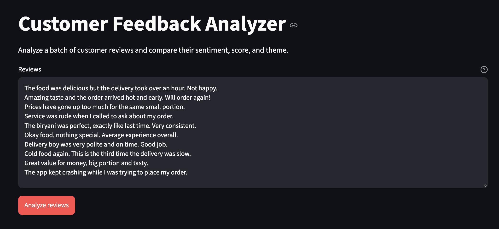
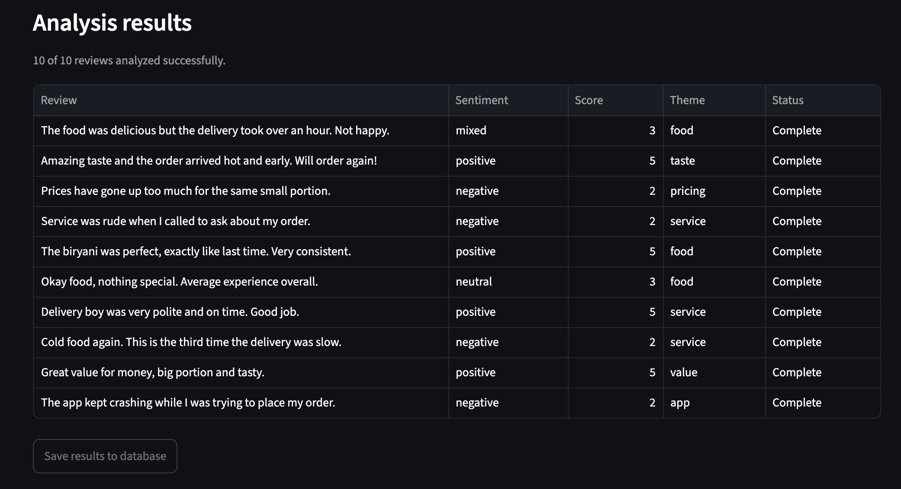
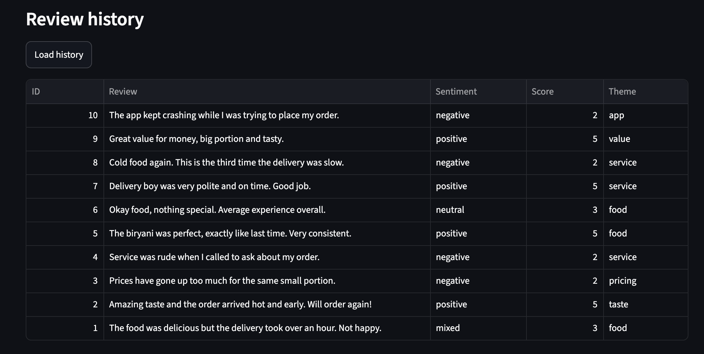

# Customer Feedback Analyzer

Analyze customer reviews using a FastAPI backend and a Streamlit interface.
Enter one review per line; the app sends each review individually to the
`/analyze` endpoint and displays its sentiment, score, theme, and analysis
status in a table. Successful results can be saved to a local SQLite database
and reviewed later.

## Screenshots







## Requirements

- Python 3.14 or newer
- [`uv`](https://docs.astral.sh/uv/)
- An OpenAI API key

Install the project dependencies from the repository root:

```bash
uv sync
```

## Run locally

Set `OPENAI_API_KEY` in your environment or in a `.env` file in the project
root. Start the FastAPI backend in one terminal:

```bash
uv run uvicorn codespaces_blank.backend:app --reload
```

In a second terminal, start the Streamlit app:

```bash
uv run streamlit run src/codespaces_blank/streamlit_app.py
```

The app defaults to the FastAPI base URL `http://localhost:8000`. Change it in
the sidebar if the backend is running at a different address.

## Use the app

1. Enter one review per line in the **Reviews** field.
2. Select **Analyze reviews** to analyze the batch.
3. Select **Save results to database** to save successful analyses.
4. Select **Load history** to display previously saved analyses.

The SQLite database is created automatically as `feedback.db` in the project
root. The repository includes [sample_reviews.txt](./sample_reviews.txt) with
example reviews you can paste into the app.

The backend also exposes FastAPI's interactive API documentation at
`http://localhost:8000/docs` while it is running.
